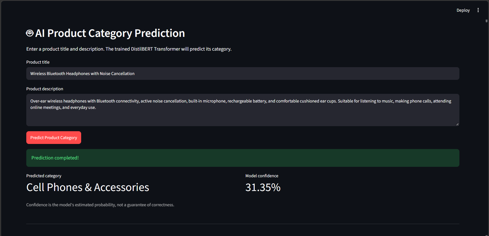
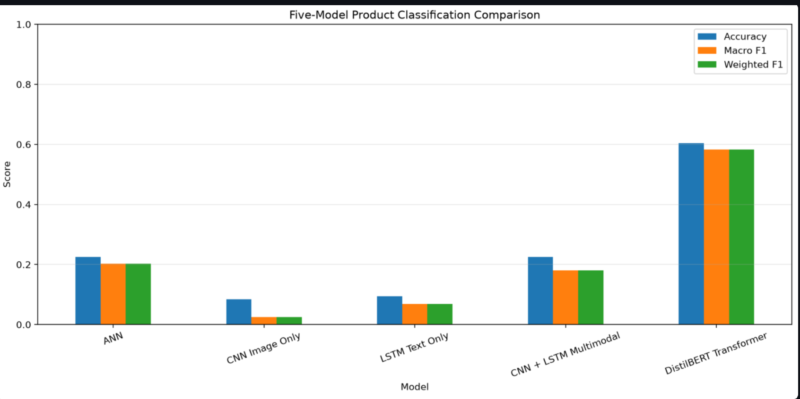
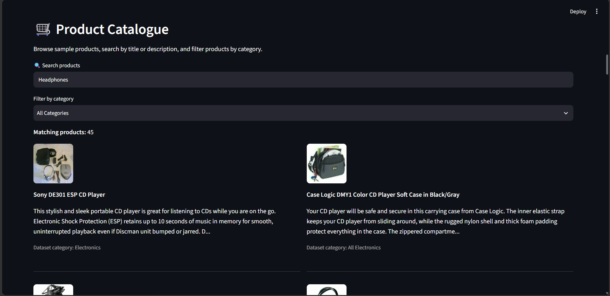
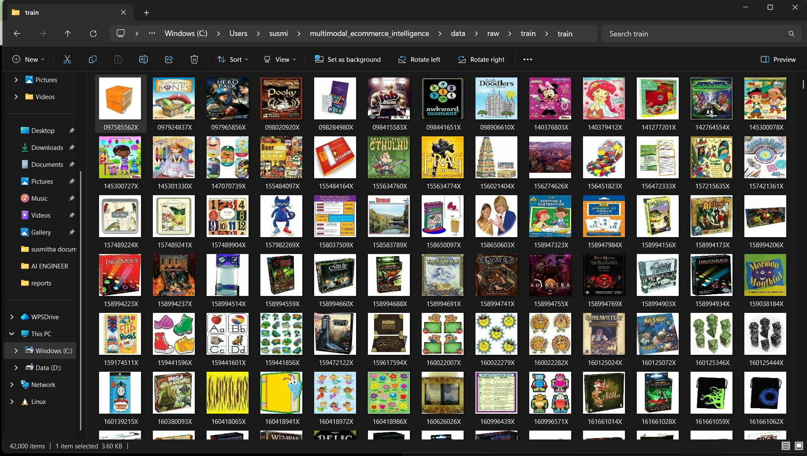

Multimodal E-Commerce Intelligence System
An AI engineering portfolio project exploring e-commerce product-category classification using engineered numerical features, computer vision, recurrent neural networks, and Transformer-based NLP. The project includes a Streamlit application for text-based category prediction, a product catalogue, and model-performance reporting.

Project Overview
The goal is to compare five approaches for classifying products into 21 categories:

Artificial Neural Network (ANN) using engineered numerical text features
Convolutional Neural Network (CNN) using product images
Long Short-Term Memory network (LSTM) using product text
CNN + LSTM using image and text features
Fine-tuned DistilBERT Transformer using product titles and descriptions
Important implementation note: The current Streamlit prediction feature uses text-only DistilBERT. The CNN, LSTM, and CNN + LSTM models were evaluated separately; the live app does not currently perform image-based prediction or multimodal fusion.

Application Screenshots
1. AI Product Category Prediction
The Streamlit interface accepts a product title and description and displays the predicted category and model confidence.

2. Model Performance Comparison
The chart compares accuracy, macro F1, and weighted F1 for the five evaluated models.

3. Product Catalogue
The catalogue supports keyword search and category filtering. The source dataset images are low resolution, so some product thumbnails may appear blurry.

4. Product Image Dataset
A view of the local product-image dataset used during project experimentation.

Model Evaluation Results
The following results were recorded during the project's validation evaluation on 8,400 examples.

Model	Input	Accuracy	Macro F1
ANN	Engineered numerical text features	22.52%	0.2027
CNN image-only	Product images	8.45%	0.0251
LSTM text-only	Product text	9.40%	0.0689
CNN + LSTM multimodal	Image and text features	22.51%	0.1805
DistilBERT Transformer	Product title and description	60.45%	0.5830
DistilBERT achieved the strongest overall result among these evaluated models. Accuracy and macro F1 are both included because accuracy alone can hide uneven performance across categories.

Features
Text-based product-category prediction using fine-tuned DistilBERT
Displays the predicted category and model confidence
Product catalogue with keyword search
Category filter
Model comparison table and chart
Saved evaluation reports
Technology Stack
Python
PyTorch
Hugging Face Transformers
Streamlit
Pandas and NumPy
scikit-learn
Matplotlib
Pillow
Project Structure
multimodal_ecommerce_intelligence/
├── app.py
├── README.md
├── requirements.txt
├── .gitignore
├── assets/
├── data/
├── models/
├── reports/
│   ├── model_comparison.csv
│   ├── model_comparison.png
│   ├── distilbert_classification_report.txt
│   └── distilbert_confusion_matrix.csv
└── screenshots/
    ├── ai_prediction.png
    ├── model_comparison.png
    ├── product_catalogue.png
    └── training_images.png
The exact files present may differ based on which generated artifacts are retained in the repository.

Run Locally
Clone or download the repository.
Create and activate a Python virtual environment.
Install the dependencies listed in requirements.txt.
Ensure the required model checkpoint and tokenizer files are available in the paths expected by app.py.
Ensure the required category mapping, catalogue data, and reports are available.
Start the app:
streamlit run app.py
Limitations
The deployed Streamlit prediction currently uses text-only DistilBERT.
CNN, LSTM, and CNN + LSTM are separate evaluated models; the current app does not combine their predictions.
The dataset product images are 100 × 100 pixels and can appear blurry when displayed.
Model predictions can be incorrect. The displayed confidence is a model probability estimate, not a guarantee of correctness.
Results may not generalize to products outside the dataset.
Future Improvements
Improve image quality in the catalogue display where suitable source images are available.
Improve category-wise performance and error analysis.
Explore stronger image-text fusion and deploy it as a live prediction feature.
Add automated tests and deployment instructions.
Author
AI Engineering portfolio project focused on model experimentation, evaluation, and application development.

0%⋮⋮⋮⋮